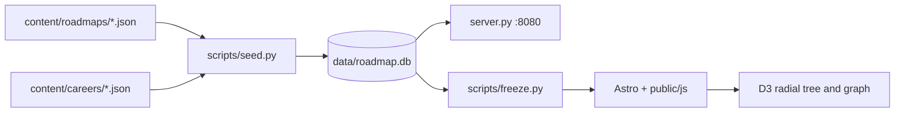

<div align="center">

# Compass

**Step-by-step career roadmaps for non-tech fields.**

[](https://adineo-cmd.github.io/compass/)
    

[](https://github.com/adineo-cmd/compass/stargazers) [](https://github.com/adineo-cmd/compass/commits)

[Live site](https://adineo-cmd.github.io/compass/) · [Quick start](#quick-start) · [How it works](#how-it-works) · [Features](#features)

</div>

---

Compass applies the roadmap.sh idea to the rest of the job market: **40 career
roadmaps, 928 interactive topics and 143 occupations** across 21 O*NET-SOC
families, with fields of study mapped to JEL codes.

No login, no accounts, no tracking. Progress lives in your browser.

## Features

| | Feature | What it does |
| --- | --- | --- |
| 🗺️ | **40 roadmaps** | 928 topics, each with notes, skills, certifications and resources. |
| 🌌 | **Two views** | An OSINT-style radial tree and a classic roadmap.sh-style graph. |
| 💼 | **143 occupations** | Linked to the official O*NET-SOC summary for each role. |
| 🔎 | **Global search** | Roadmaps, topics and occupations from one search box. |

## How it works

Content is JSON; both the site and the standalone server read the same data:

1. `content/roadmaps/*.json` and `content/careers/*.json` hold the authored data.
2. `scripts/seed.py` builds `data/roadmap.db` (SQLite, standard library only).
3. `python3 server.py` serves the zero-dependency version on port 8080.
4. `npm run dev` runs the Astro version, with `predev` seeding the database and
   freezing the content for the browser.



## Quick start

**Install and run**

```bash
npm install
npm run dev
```

**Production build**

```bash
npm run build
npm run preview
```

## Project structure

```text
content/roadmaps/   40 roadmap JSON files
content/careers/    occupations and fields of study
scripts/            seed, freeze and validate
src/pages/          Astro entry
public/js/          D3 radial tree, graph and search
server.py           dependency-free local server
```

## Deployment

Every push to `main` builds the site and deploys it to GitHub Pages
through `.github/workflows/deploy.yml`:

**https://adineo-cmd.github.io/compass/**

## Two ways to run it

```bash
# Zero dependencies (Python standard library only)
python3 scripts/seed.py
python3 server.py                 # http://127.0.0.1:8080

# Astro development build
npm install
npm run dev
```

Validate all roadmap content against the schema with
`python3 scripts/validate.py`.
